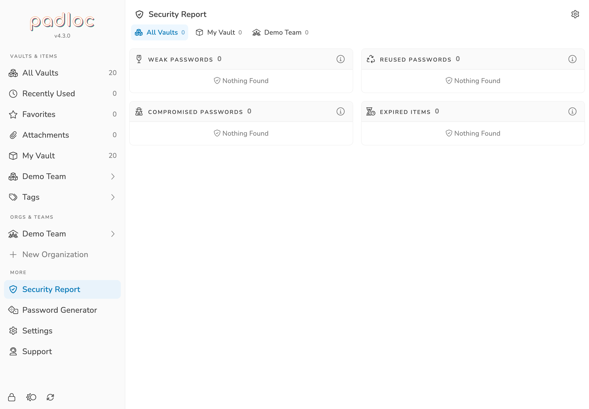

Open **Security Report** from the main menu to review potential problems in your
vault items. Availability depends on your account or organization's enabled
features.

<figure>
    
    <figcaption>The report groups findings by the kind of action needed.</figcaption>
</figure>

## Understanding Results

-   **Weak Passwords** are easy to guess, for example because they are short or
    predictable. Replace them with strong, randomly generated passwords.
-   **Reused Passwords** appear in more than one password field. Give each
    service a unique password so a leak at one service does not expose other
    accounts.
-   **Compromised Passwords** match passwords found in known data breaches.
    Change these passwords at the affected services promptly.
-   **Expired Items** have passed the
    [expiration period](../vaults/#expiration-period) you set for them. Review
    the credential and update the item after changing it at the service.

Each category previews up to five items. Select an item to open it, or use
**Show All** when there are more results. The information button beside a
category explains that check. When you belong to an organization, the report
also offers filters for **All Vaults**, **My Vault**, and your organizations.

An item can appear in more than one category. **Nothing Found** means the check
has no recorded findings; it is not a guarantee that an account is secure.

## Choosing Checks

Use the cog button in the report to open **Settings → Security**. Under
**Security Report**, enable or disable individual checks. If you disable every
check, the report shows that all security reports have been disabled.

The compromised-password check uses the Pwned Passwords service. Padloc hashes
each password locally and sends only the first five characters of the hash to
look up possible matches, then compares the returned results locally. This check
requires an internet connection; the plaintext password is not sent to the
lookup service.

## Resolving Findings

Open the affected item and use the
[password generator](../vaults/#generating-passwords) to choose a replacement.
Change the password with the service, save the corresponding value in Padloc,
and review other items that used the old password. Editing the saved value in
Padloc alone does not update the service.

For expired items, update the credential or remove the expiration period if it
no longer applies. Keep checks enabled for the issues you want Padloc to flag.
